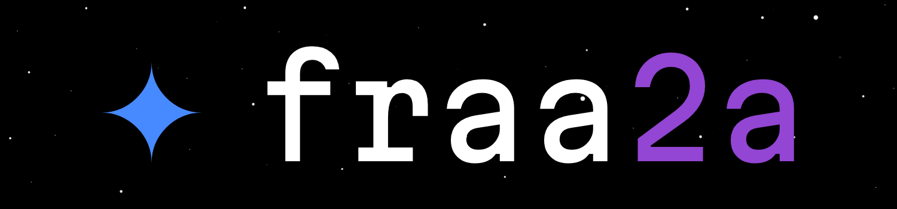

---

## 👋 About me

I'm **Francesco**, a software developer based in Italy.
I design and ship cross-platform desktop apps, terminal tools and websites, built with Rust and modern web technologies.

I own the architecture and every technical decision. AI turns my plans into code, so I can ship fast without losing control of what's inside.

Most of my projects start with _"I could probably build that"_ and turn out considerably larger.

🌐 **Portfolio:** [fraa2a.dev](https://www.fraa2a.dev/)

  

## What I do

- **Desktop & terminal software**: cross-platform apps and tools in Rust and Tauri
- **Websites**: built end to end, from design to deploy
- **Systems & self-hosting**: Linux, servers and infrastructure

## Projects

- **[Legio](https://github.com/fraa2a/Legio)**: cross-platform game launcher built with Tauri, Rust and Svelte.

More at [fraa2a.dev](https://www.fraa2a.dev/).

## AI & development

I own the architecture and every technical decision: I plan the work, define the structure and review what ships.
AI turns those plans into code. It handles the repetitive, slow parts so I can **spend less time on long tasks and work on multiple projects at once**.

## Stack

  
  
  
  
  
  

